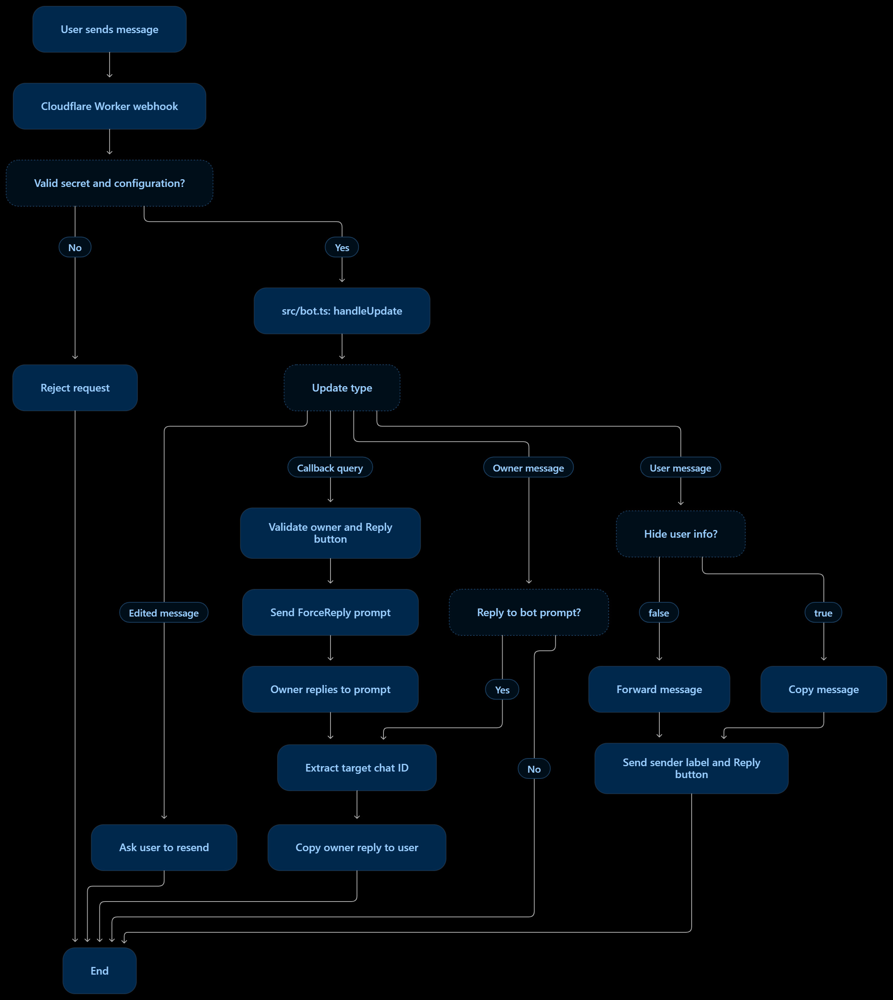

<h1> Telegram Anonymous Bot: TypeScript + GitHub + Cloudflare Workers — serverless, no database </h1>

- [Introduction](#introduction)
- [Features](#features)
- [Requirements](#requirements)
- [Installation](#installation)
- [Deployment](#deployment)
  - [1. Create a Cloudflare Worker](#1-create-a-cloudflare-worker)
  - [2. Configure Secrets](#2-configure-secrets)
  - [3. Set Up the Telegram Webhook](#3-set-up-the-telegram-webhook)
  - [4. Test Your Bot](#4-test-your-bot)
- [Flow Diagram](#flow-diagram)
- [Structure](#structure)
- [Detailed Workflow by File](#detailed-workflow-by-file)
- [Tasks](#tasks)
- [License](#license)
- [Support](#support)

# Introduction
**Telegram Anonymous Bot** is a lightweight, serverless Telegram bot built with TypeScript and Cloudflare Workers. It allows users to communicate with a bot owner without requiring a traditional server, a database, or persistent storage.

The bot receives messages from users and delivers them to the owner, who can respond directly through Telegram using an inline Reply button. Replies can include supported message types, including stickers, without requiring a separate user-to-message database.

Privacy is configurable through the `HIDE_USER_INFO` environment variable:

- **`false`** — forwards user messages to the owner and displays the sender's name.
- **`true`** — copies user messages instead of forwarding them and displays the sender as `Hidden User`.

The bot uses Telegram's Bot API for message delivery and Cloudflare Workers for webhook processing. It is designed to be simple to deploy, easy to customize, and suitable for running multiple bot instances through separate Cloudflare environments.

No application database is required. The bot relies on Telegram's chat IDs, message IDs, and reply prompts to route messages and responses.

# Features
- **Anonymous messaging:** Receive messages from Telegram users without exposing their identity to the bot owner when anonymous mode is enabled.
- **Direct replies:** The bot owner can reply to forwarded user messages.
- **Media support:** Forward supported Telegram message types, including text, photos, videos, documents, and stickers.
- **Hide User Info:** Optionally hide sender information using the `HIDE_USER_INFO` configuration variable.
- **Serverless architecture:** Runs on Cloudflare Workers without managing a traditional server.
- **No database required:** Does not store messages or user data in a database.
- **Webhook security:** Validates Telegram webhook requests using a secret token.
- **Environment-based secrets:** Keeps bot credentials and sensitive configuration outside the source code.

# Requirements
Before deploying your bot, prepare the following:
1. A [GitHub](https://github.com/) account.
2. A [Cloudflare](https://dash.cloudflare.com/) account.
3. A Telegram bot created using [@BotFather](https://t.me/BotFather).

You will need these credentials:
| Secret | Description |
|---|---|
| `TELEGRAM_BOT_TOKEN` | The token provided by BotFather. |
| `OWNER_CHAT_ID` | Your Telegram chat ID. |
| `TELEGRAM_WEBHOOK_SECRET` | A secret token used to validate Telegram webhook requests. |

Optional configuration:
| Variable | Description |
|---|---|
| `HIDE_USER_INFO` | Set to `"true"` to hide sender information, or `"false"` to disable this feature. |

Keep all secrets private. Never add credentials directly to source code or commit them to GitHub.

# Installation
No local software installation is required. You can set up the project entirely through your web browser (but if you are a developer, you can do whatever you want :D).

1. Open this repository on GitHub.
2. Click **Fork** to create your own copy under your GitHub account.
3. Open your forked repository.
4. If you want to customize the bot, edit `wrangler.jsonc` directly on GitHub.

You do not need to install anything on your computer.

# Deployment

## 1. Create a Cloudflare Worker

1. Sign in to the [Cloudflare Dashboard](https://dash.cloudflare.com/).
2. Open **Workers & Pages**.
3. Create a Worker and choose the option to deploy from a Git repository, if available.
4. Connect your GitHub account and select your forked repository.
5. Configure the build and deployment settings according to the project's `wrangler.jsonc` and Cloudflare's current interface.

## 2. Configure Secrets
Open your Worker in the Cloudflare Dashboard and locate **Settings → Variables and Secrets**.

Add the following secrets:
- `TELEGRAM_BOT_TOKEN`
- `OWNER_CHAT_ID`
- `TELEGRAM_WEBHOOK_SECRET`

Add the optional `HIDE_USER_INFO` variable under the appropriate environment's variables.

Use the correct environment configuration for your bot. **Never place secret values in `wrangler.jsonc` or your GitHub repository.**

## 3. Set Up the Telegram Webhook
Telegram needs to know where to deliver incoming messages. You must register your deployed Cloudflare Worker URL as the bot's webhook.

1. Copy your Cloudflare Worker's URL.
2. Append `/telegram` to the URL. For example:
   `https://YOUR-WORKER-NAME.YOUR-SUBDOMAIN.workers.dev/telegram`
3. Open the following URL in your browser, replacing the placeholders with your actual values:
   `https://api.telegram.org/bot<TELEGRAM_BOT_TOKEN>/setWebhook?url=<WORKER_WEBHOOK_URL>&secret_token=<TELEGRAM_WEBHOOK_SECRET>`
   Replace:
   - `<TELEGRAM_BOT_TOKEN>` with your bot token.
   - `<WORKER_WEBHOOK_URL>` with your complete Worker URL, including `/telegram`.
   - `<TELEGRAM_WEBHOOK_SECRET>` with the same secret configured in Cloudflare.
4. Check Telegram's response. A successful registration should return `"ok": true`.

**Security warning:** This URL contains your bot token and webhook secret. Do not share it, commit it to GitHub, or post it publicly. Avoid leaving it in browser history on a shared computer.

## 4. Test Your Bot
1. Open your bot in Telegram.
2. Send `/start`.
3. Send a test message.
4. Verify that the owner receives the message and can reply.

Your bot is now ready to use.

**Note:** Cloudflare's dashboard options and Git integration can change. If the dashboard cannot build this TypeScript project directly from the repository, a compatible Cloudflare build configuration or browser-based deployment workflow may be necessary. No local installation is required for the user.


# Flow Diagram


# Structure
```
├───src
│   └───index.ts
│   └───bot.ts
│   └───telegram.ts
│   └───types.ts
│   └───env.d.ts
├───wrangler.jsonc
```

# Detailed Workflow by File
1. src/index.ts: Receives HTTP requests, validates the webhook secret, reads the configuration, parses Telegram updates, and calls the bot handler.
2. src/bot.ts: Contains the main bot logic, privacy-mode selection, message routing, Reply button handling, and owner-to-user replies.
3. src/telegram.ts: Wraps Telegram Bot API calls, including sending, forwarding, copying messages, and handling inline buttons.
4. src/types.ts: Defines TypeScript interfaces for Telegram updates, messages, users, chats, and callback queries.
5. src/env.d.ts: Defines the environment variables required by the Worker.
6. wrangler.jsonc: Configures Cloudflare Worker deployment and the bot01–bot04 environments.

# Tasks
- [x] Show start message to user
- [x] Forward user's message to admin
- [x] Inform user to send their edited messages again  
- [x] Hide user info
- [x] Admin can reply to users 
- [x] Admin can reply with stickers
- [ ] Show reply as a button (if possible)
- [ ] Admin can block/unblock users

# License
This project is distributed under the license included in the repository. Please review the `LICENSE` file before using, modifying, or distributing the code.

# Support
If you encounter a problem or have a question:

- Open an issue in the GitHub repository.
- Include relevant error messages and steps to reproduce the issue.
- Never share your bot token, webhook secret, or other credentials in public issues.

GitHub repository: [telegram-anonymous-bot](https://github.com/shSalmanian/telegram-anonymous-bot)